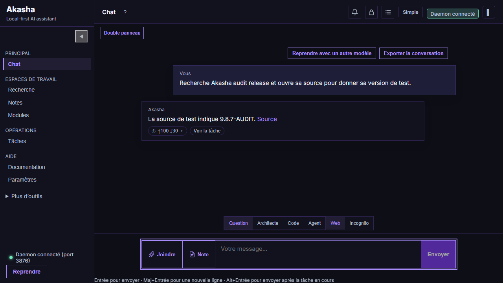
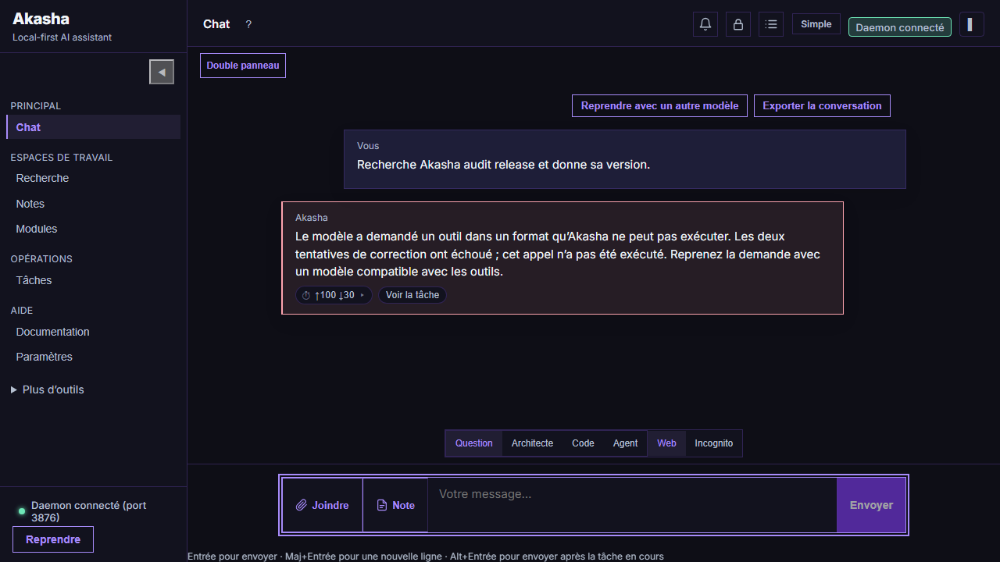

# Audit du chat et de la gestion des agents — 26 octobre 2026

Les correctifs sont présents dans le dépôt, sur `codex/fix-chat-agent-results`. L’audit final obtient **22 scénarios contrôlés conformes, 8 scénarios avec Qwen 3.5 9B conformes et 6 tests d’interface réussis**. Les scénarios d’erreur attendent un refus ou un échec explicite : ils ne sont pas comptés comme des actions accomplies.

## Défauts corrigés

| Défaut constaté | Comportement corrigé |
| --- | --- |
| Le mode Question pouvait déclencher une orchestration après une relance `?`. | Routage direct vers un rôle Question, à partir du message original. Les préférences et consignes internes ne modifient plus la complexité de la demande. |
| Le mode Question reposait principalement sur des consignes au modèle. | La liste d’outils et le contrôle d’exécution interdisent les écritures, commandes, installations et délégations. |
| Un JSON `tool_use`, un marqueur Liquid ou un appel placé dans un bloc de code devenait la réponse finale sans exécution. | Outils natifs pour les opérations courantes ; deux tentatives de réparation au maximum pour les propositions non exécutées, puis erreur explicite. Les blocs structurés sont retenus pendant le streaming avant leur interprétation. |
| Une promesse d’agir pouvait fermer la tâche. | Les promesses d’action courtes sont réparées ; une promesse répétée produit un échec explicite. |
| Le parseur ajoutait un saut de ligne avant le dernier mot d’un `write_file` dont le contenu était sur la même ligne. | Le contenu de l’en-tête est conservé comme un seul argument littéral, avec ses espaces, guillemets et caractères Unicode. `write_code` prend également en charge un corps sur plusieurs lignes. |
| Le modèle pouvait modifier un texte demandé exactement ou annoncer un fichier sans aucune écriture. | Contrôle des littéraux explicitement reconnus, refus des contenus différents, nombre de corrections borné et exigence d’un appel de modification réussi. |
| Une demande de lecture après écriture ou d’ouverture de la source pouvait être oubliée après un premier résultat. | La demande complète reste active entre les appels ; contrôle de ces étapes explicites avant la réponse finale. |
| Le retour d’attente du coordinateur pouvait remplacer un échec de sous-agent par `completed`. | Le coordinateur conserve le statut produit par le worker et interrompt une attente expirée sans annoncer sa réussite. |
| Une étape dépendante pouvait démarrer malgré l’échec de son prérequis. | L’étape dépendante reste bloquée ; un événement explique le prérequis manquant. |
| Le planificateur pouvait recopier les valeurs d’exemple de son schéma comme instructions réelles. | Les plans contenant ces valeurs sont rejetés au profit de la demande originale. |
| Une réponse invalide de l’évaluateur était assimilée à `SATISFACTORY`. | Seule une valeur explicite reconnue atteste la satisfaction ; une sortie invalide ou un délai déclenche une reprise de la réponse. |
| Le polling pouvait afficher un texte provisoire ou une réponse enfant après le statut terminal du parent. | Réponse finale enregistrée atomiquement avec le statut ; la réponse du parent reste la dernière réponse du chat. |
| Les deltas de texte effaçaient rapidement les preuves d’appels d’outils dans l’historique limité à 64 événements. | Les reçus d’outils et les événements de fin sont conservés en priorité, avec la même limite de stockage. |
| Les exemples `TOOL:` étaient interprétés ou supprimés dans les réponses pédagogiques. | Un exemple dans un bloc de code reste du texte et apparaît intégralement dans la réponse. |
| Le modèle devait deviner la version locale d’Akasha. | La version du daemon en cours est fournie comme fait d’exécution, distinct de la dernière release publiée et de la version éventuelle d’une UI installée séparément. |

## Méthode et preuves

Les tests utilisent un daemon Windows recompilé, des ports libres et un répertoire temporaire distinct pour chaque exécution. Ils ne se connectent pas à la base personnelle d’Akasha. Les réponses, statuts, reçus d’outils et octets des fichiers sont contrôlés séparément.

Le fournisseur contrôlé reproduit les formats incorrects de la capture puis des réponses réparées, ainsi que des annonces volontairement fausses de réussite. Les recherches et pages sources sont servies par un serveur HTTP local. La version `9.8.7-AUDIT` est une **donnée synthétique de test**, pas une release d’Akasha.

Le second passage utilise réellement **Ollama / `qwen3.5:9b`**, avec vérification du modèle enregistré par Akasha. Les outils de fichiers, de recherche et de lecture de page sont effectivement exécutés ; la page web reste une source de test locale pour rendre le contrôle reproductible.

- [Résultats contrôlés finaux](deterministic.json) : scénarios, contrôles, statuts, réponses, arbre de tâches et événements.
- [Résultats Qwen finaux](ollama-qwen3.5-9b.json) : modèle effectif, reçus et contenu du fichier Unicode.
- [Premier passage Qwen](ollama-initial.json) : les échecs ayant motivé les corrections supplémentaires pendant l’audit.
- Les deux rapports finaux enregistrent les empreintes SHA-256 des sources modifiées et du daemon testé. Le champ `dirty` indique que les corrections n’étaient pas encore commitées pendant les mesures.

## Scénarios contrôlés

| Scénario | Résultat attendu et observé |
| --- | --- |
| Question factuelle | Réponse pertinente ; rôle Question direct. |
| Relance `?` | Historique de la session normale conservé ; aucune orchestration. |
| Version courante | Version du daemon obtenue depuis les faits d’exécution. |
| Lecture d’un fichier | Appel réussi à `read_file` et restitution de `CANARY_42`. |
| Recherche puis source | `web_search`, puis `web_fetch` réussis ; valeur de la page et citation. |
| Écriture Unicode puis lecture | Octets exactement égaux à `Bonjour été 🙂`, puis appel de lecture réussi. |
| Écriture en mode Question | Aucun fichier créé ; refus conforme au mode. |
| Exemple de syntaxe | Exemple affiché, aucune commande exécutée. |
| Incognito | L’historique de la session est exclu, conformément au mode. |
| JSON `tool_use` incorrect | Réparation, exécution réelle, réponse factuelle. |
| Promesse sans action | Réparation, exécution réelle, réponse factuelle. |
| Marqueur Liquid incorrect | Réparation, lecture réelle, réponse factuelle. |
| Appel exécutable placé dans un bloc de code | Réparation, lecture réelle, réponse factuelle. |
| JSON incorrect persistant | Deux réparations au maximum, puis tâche en échec ; aucun protocole brut dans la réponse. |
| Promesse persistante après un outil | Échec explicite ; aucun faux succès. |
| Chemin d’écriture refusé | Refus réel et absence de réussite annoncée. |
| Fichier annoncé sans outil | Échec explicite ; annonce de création remplacée par l’erreur finale. |
| Fichier annoncé après une simple lecture | Échec explicite ; une lecture ne vaut pas modification. |
| Plan reprenant les valeurs du schéma | Demande originale conservée ; aucun faux objectif d’exemple. |
| Deux sous-agents avec dépendance | Deux étapes exécutées dans l’ordre ; résultat du premier transmis au second. |
| Échec du premier sous-agent | Étape dépendante non démarrée ; parent et enfants gardent des statuts cohérents. |
| Annulation pendant la génération | Statut annulé conservé après le retour tardif du modèle. |

## Passage avec le modèle réel

Les huit contrôles suivants passent avec `qwen3.5:9b` : question factuelle, relance, version locale, lecture de fichier, recherche avec ouverture de source, écriture Unicode suivie de lecture, respect du mode Question et exemple de syntaxe sans exécution.

Le fichier du scénario d’écriture contient exactement `Bonjour été 🙂`. Les deux reçus `write_file` et `read_file` sont présents dans les preuves finales. La réponse cite sa relecture réelle.

## Interface et régressions

- **722 tests Rust du daemon réussis**, un test existant ignoré ; **32 tests du stockage réussis**.
- **70 tests unitaires de l’interface réussis**.
- **3 tests Chromium du chat réussis** : réponse simple, réparation suivie du résultat web, erreur visible après épuisement des réparations.
- **3 tests Chromium des réponses humaines réussis** : question expirée, question remplacée et retrait d’une question périmée.
- Compilation TypeScript/Vite et `cargo check` de la couche Tauri réussis.
- Le transport IPC Tauri est remplacé dans les trois tests Chromium du chat ; l’interface React dialogue ensuite avec le véritable daemon isolé. Cela ne constitue pas un lancement du paquet Windows installé.





## Reproduire

Depuis la racine du dépôt :

```powershell
cargo test --locked -p akasha-daemon -p akasha-store --no-default-features --lib
cargo build --locked -p akasha-daemon --no-default-features --bin akasha-daemon
python spec/dev/quality/chat_agent_audit.py --ui
python spec/dev/quality/chat_agent_audit.py --model qwen3.5:9b --output docs/validation/chat-agent-audit-2026-10-26/ollama-qwen3.5-9b.json
```

Le passage avec `--ui` utilise le build existant de `apps/akasha-ui` : exécuter `npm run build` dans ce dossier après une modification de l’interface. Le passage Qwen nécessite ce modèle disponible dans Ollama. `--cases` permet une relance ciblée, par exemple `--cases write_verify`.

## Portée restante

Les formats de panne des routes OpenRouter/Nemotron/Liquid ont été reproduits avec un fournisseur contrôlé ; ces services distants n’ont pas été retestés en ligne. La sélection de modèles distincts par spécialiste n’est pas couverte par le passage Qwen, qui fixe toutes les routes au même modèle.

Les contrôles de texte exact et d’étapes explicites portent sur les formulations reconnues et testées. Ils ne constituent pas une vérification sémantique universelle de toute demande libre ou de tout projet. Une sortie de modèle demeure distincte d’une preuve d’acceptation complète (`acceptance_verified` n’est pas inventé).

L’installation personnelle `C:\Akasha` n’a pas été remplacée. Les correctifs sont prêts dans le dépôt et dans le daemon de développement recompilé ; un build ou une distribution de cette révision est nécessaire pour les utiliser dans l’application installée.
